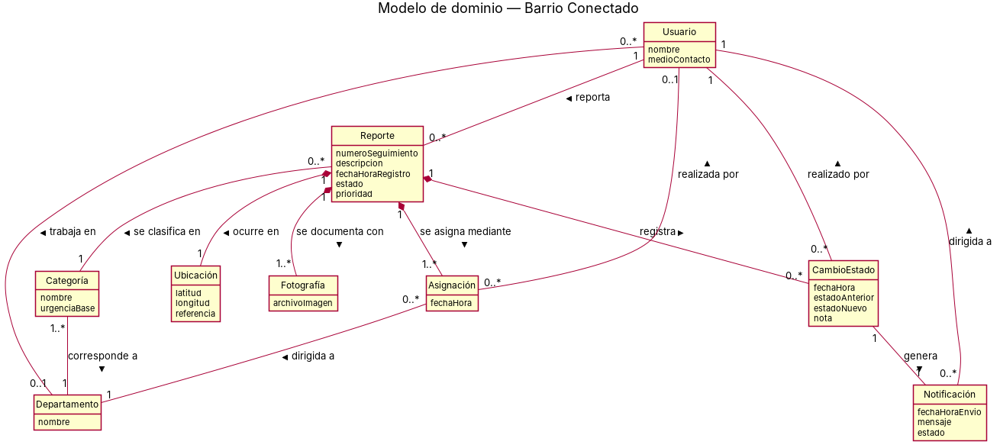

# Modelo de dominio

## Diagrama

Archivo fuente: [`./diagramas/modelo-dominio.puml`](./diagramas/modelo-dominio.puml)

## Descripción de las clases

| Clase | Qué representa en el negocio | Atributos |
|---|---|---|
| Usuario | Persona registrada en la plataforma. Puede ser un vecino que reporta problemas o un funcionario municipal que los gestiona. | nombre, medioContacto, rol (vecino/admin), hashContraseña, tokenSesion, fechaUltimoAcceso |
| Reporte | Aviso de un problema en la vía pública hecho por un vecino. Avanza por distintos estados hasta quedar completado o descartado. | numeroSeguimiento, descripcion, fechaHoraRegistro, estado, prioridad, urgente (bool) |
| Categoría | Tipo de problema que se puede reportar (luminaria, microbasural, bache u otro) y su urgencia habitual. | nombre, urgenciaBase, departamentoPorDefecto |
| Departamento | Unidad del municipio responsable de atender cierto tipo de problemas (por ejemplo alumbrado, obras o aseo). | nombre |
| Ubicación | Lugar de la vía pública donde ocurre el problema. | latitud, longitud, referencia |
| Fotografía | Imagen que muestra el problema reportado. | archivoImagen |
| CambioEstado | Registro de cada vez que cambia el estado de un reporte, con la nota de resolución o el motivo del descarte. | fechaHora, estadoAnterior, estadoNuevo, nota |
| Asignación | Registro de a qué departamento se asignó un reporte y cuándo, incluidas las reasignaciones. | fechaHora, departamentoOrigen, departamentoDestino |
| Notificación | Aviso que recibe el vecino cuando cambia el estado de su reporte. | fechaHoraEnvio, mensaje, estado (pendiente/enviada/no entregada) |
| Sesion | Registro de autenticación activa de un usuario. | token, fechaCreacion, fechaExpiracion, dispositivo |

## Asociaciones

| Asociación | Clases | Multiplicidades | Justificación |
|---|---|---|---|
| reporta | Usuario – Reporte | 1 a 0..* | Cada reporte tiene un único autor, y un vecino puede enviar muchos reportes (HU-01, HU-02). |
| se clasifica en | Reporte – Categoría | 0..* a 1 | Todo reporte pertenece a una categoría, y una categoría agrupa muchos reportes (RP-01). |
| corresponde a | Categoría – Departamento | 1..* a 1 | Cada categoría tiene un departamento responsable por defecto, y un departamento atiende una o más categorías (RP-05). |
| trabaja en | Usuario – Departamento | 0..* a 0..1 | Los funcionarios municipales pertenecen a un departamento. Los vecinos no pertenecen a ninguno. |
| ocurre en | Reporte – Ubicación | 1 a 1 | Un reporte se refiere a un único lugar, y ese lugar solo tiene sentido dentro de su reporte (RP-01). |
| se documenta con | Reporte – Fotografía | 1 a 1..* | Un reporte exige al menos una foto como evidencia (RP-01). |
| registra | Reporte – CambioEstado | 1 a 0..* | Un reporte recién recibido no tiene cambios, y luego acumula un historial de cambios (HU-02, HU-04, HU-07). |
| se asigna mediante | Reporte – Asignación | 1 a 1..* | Todo reporte se asigna a un departamento al registrarse, y puede reasignarse después (HU-08). |
| dirigida a | Asignación – Departamento | 0..* a 1 | Cada asignación apunta a un único departamento, y un departamento recibe muchas asignaciones. |
| realizada por | Asignación – Usuario | 0..* a 0..1 | La asignación inicial la hace el sistema (sin usuario). Una reasignación la hace un funcionario (HU-08). |
| realizado por | CambioEstado – Usuario | 0..* a 1 | Todo cambio de estado lo registra un funcionario (HU-04, HU-07). |
| genera | CambioEstado – Notificación | 1 a 1 | Cada cambio de estado produce una notificación al vecino (RP-08, HU-05). |
| dirigida a | Notificación – Usuario | 0..* a 1 | Cada notificación tiene un único destinatario, que es el vecino autor del reporte. |
| autentica | Usuario – Sesion | 1 a 0..* | Un usuario puede tener múltiples sesiones activas (múltiples dispositivos); cada sesión pertenece a un usuario (RP-12). |

## Decisiones de modelado

- "Vecino" y "administrador municipal" se modelaron como roles y no como clases. Ambos son personas registradas (Usuario) que cumplen un papel distinto: el vecino es el *autor* de un reporte y el *destinatario* de sus notificaciones, y el administrador es un *funcionario* que trabaja en un Departamento. Así se evita duplicar atributos y se refleja que lo que cambia es el papel, no el tipo de persona.
- Se usó composición para Ubicación, Fotografía, CambioEstado y Asignación, porque no existen sin el reporte al que pertenecen: si el reporte desaparece, también su ubicación, sus fotos y su historial. El resto de las relaciones son asociaciones simples. No se usó herencia, porque no hay conceptos del negocio que sean un caso particular de otro.
- El estado (Recibido, En revisión, Descartado, Completado) y la prioridad (alta, media, baja) se modelaron como atributos de Reporte. El detalle de cómo cambia el estado se explica en el diagrama de estado EST-01 del documento 11.
- La Junta de Vecinos del AS-IS no aparece en el modelo, porque en el TO-BE de la Entrega 1 deja de ser intermediaria del proceso.
- Los sistemas externos (mapas o geolocalización y envío de notificaciones) no son conceptos del negocio, así que no se modelan aquí. Aparecen como actores en los casos de uso y como participantes en los diagramas de secuencia.
