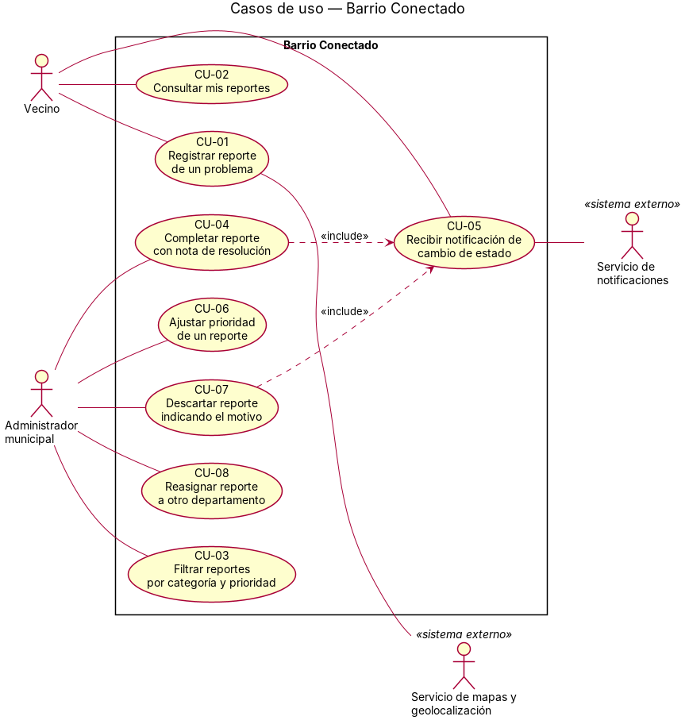

# Casos de uso

## Actores

| Actor | Tipo (humano / sistema externo) | Descripción |
|---|---|---|
| Vecino | Humano | Usuario registrado que reporta problemas en la vía pública y realiza seguimiento. |
| Administrador municipal | Humano | Funcionario que filtra, prioriza, asigna y actualiza el estado de los reportes. |
| Sistema de Geolocalización | Sistema externo | Servicio de mapas que provee y valida coordenadas geográficas para las ubicaciones. |
| Sistema de Notificaciones | Sistema externo | Plataforma encargada de despachar los avisos al vecino cuando hay cambios de estado. |

## Diagrama de casos de uso

Archivo fuente: [`./diagramas/casos-de-uso.puml`](./diagramas/casos-de-uso.puml)

## Casos de uso y su origen

| ID | Caso de uso (objetivo del actor) | Actor principal | Historia de origen |
|---|---|---|---|
| CU-01 | Registrar un reporte de incidente | Vecino | [HU-01](./04-historias-usuario.md#hu-01) |
| CU-02 | Consultar historial de reportes | Vecino | [HU-02](./04-historias-usuario.md#hu-02) |
| CU-03 | Filtrar reportes para asignación | Administrador municipal | [HU-03](./04-historias-usuario.md#hu-03) |
| CU-04 | Completar reporte con nota de resolución | Administrador municipal | [HU-04](./04-historias-usuario.md#hu-04) |
| CU-05 | Recibir notificación de cambio de estado | Vecino | [HU-05](./04-historias-usuario.md#hu-05) |
| CU-06 | Ajustar prioridad de un reporte | Administrador municipal | [HU-06](./04-historias-usuario.md#hu-06) |
| CU-07 | Descartar reporte indicando el motivo | Administrador municipal | [HU-07](./04-historias-usuario.md#hu-07) |
| CU-08 | Reasignar reporte a otro departamento | Administrador municipal | [HU-08](./04-historias-usuario.md#hu-08) |
| CU-09 | Iniciar sesión / Registrarse | Vecino / Administrador municipal | [RP-12](./03-requisitos.md) |

## Descripción de casos de uso (formato extendido)

### CU-01 — Registrar un reporte de incidente
- **Actor principal:** Vecino
- **Precondición:** El vecino está autenticado en la aplicación.
- **Flujo principal:**
  1. El vecino accede a la pantalla de nuevo reporte.
  2. El vecino selecciona categoría, toma/adjunta fotografía, ingresa descripción y confirma ubicación (GPS o mapa).
  3. Opcionalmente, marca la casilla "Urgente".
  4. El vecino envía el reporte.
  5. El sistema valida que todos los campos obligatorios estén completos.
  6. El sistema invoca al Servicio de Geolocalización para validar la ubicación.
  7. Si la ubicación es válida, el sistema registra el reporte con estado "Recibido", asigna número de seguimiento, prioridad automática y departamento correspondiente.
  8. El sistema muestra la confirmación con el número de seguimiento al vecino.
- **Flujos alternativos:**
  - 5a. Faltan datos obligatorios → El sistema indica qué campos faltan y no envía.
  - 6a. Ubicación no válida → El sistema solicita una nueva ubicación.
- **Postcondición:** El reporte queda guardado con estado "Recibido" y notificación pendiente de envío al vecino (confirmación de recepción).

### CU-02 — Consultar historial de reportes
- **Actor principal:** Vecino
- **Precondición:** El vecino está autenticado y tiene al menos un reporte registrado.
- **Flujo principal:**
  1. El vecino accede a "Mis reportes".
  2. El sistema muestra la lista de reportes del vecino con fecha, categoría, prioridad y estado actual.
  3. El vecino selecciona un reporte.
  4. El sistema muestra el detalle del reporte con el historial completo de cambios de estado (fecha, estado anterior, estado nuevo, nota/motivo).
- **Flujos alternativos:**
  - 1a. El vecino no tiene reportes → El sistema muestra lista vacía con mensaje informativo.
- **Postcondición:** El vecino visualiza el estado y trazabilidad de sus reportes.

### CU-03 — Filtrar reportes para asignación
- **Actor principal:** Administrador municipal
- **Precondición:** El administrador está autenticado y tiene rol de administrador.
- **Flujo principal:**
  1. El administrador accede al panel de gestión de reportes.
  2. El sistema muestra la lista completa de reportes con filtros: categoría, prioridad, estado, departamento asignado, rango de fechas.
  3. El administrador aplica uno o más filtros y/o ordena por prioridad (mayor a menor).
  4. El sistema actualiza la lista mostrando solo los reportes que cumplen los criterios.
  5. El administrador selecciona un reporte para ver su detalle y/o cambiar su estado/asignación.
- **Flujos alternativos:**
  - 3a. No hay resultados para los filtros → El sistema indica "Sin resultados" y mantiene los filtros activos.
- **Postcondición:** El administrador tiene una vista filtrada y ordenada para priorizar su trabajo.

### CU-04 — Completar reporte con nota de resolución
- **Actor principal:** Administrador municipal
- **Precondición:** El administrador está autenticado; el reporte está en estado "En revisión".
- **Flujo principal:**
  1. El administrador selecciona un reporte en "En revisión".
  2. El administrador cambia el estado a "Completado" e ingresa la nota de resolución obligatoria.
  3. El sistema valida que la nota no esté vacía.
  4. El sistema actualiza el estado a "Completado", registra el cambio de estado (fecha, hora, usuario, nota).
  5. El sistema invoca al Servicio de Notificaciones para avisar al vecino.
  6. El sistema confirma al administrador que el reporte se completó y la notificación fue enviada (o quedó pendiente).
- **Flujos alternativos:**
  - 3a. Nota de resolución vacía → El sistema rechaza el cambio y exige la nota.
  - 5a. Servicio de notificaciones no disponible → El sistema registra la notificación como "Pendiente de envío" y programa reintentos; informa al administrador.
- **Postcondición:** El reporte pasa a "Completado"; el vecino es notificado (o la notificación queda en cola).

### CU-05 — Recibir notificación de cambio de estado
- **Actor principal:** Vecino
- **Precondición:** El vecino tiene un reporte registrado; el Servicio de Notificaciones está operativo.
- **Flujo principal:**
  1. Ocurre un cambio de estado en uno de los reportes del vecino (por acción de CU-04, CU-07 o inicio de revisión).
  2. El sistema genera una notificación con número de seguimiento, nuevo estado y nota/motivo si aplica.
  3. El sistema invoca al Servicio de Notificaciones para enviar el push al dispositivo del vecino.
  4. El Servicio de Notificaciones confirma la entrega.
  5. El sistema actualiza el estado de la notificación a "Enviada" con fecha/hora.
- **Flujos alternativos:**
  - 3a. Servicio no disponible → El sistema registra "Pendiente de envío" y programa reintentos (EST-02).
  - 4a. Plazo máximo de entrega vencido → El sistema marca la notificación como "No entregada".
- **Postcondición:** El vecino recibe la notificación en su dispositivo (o queda en cola para reintento).

### CU-06 — Ajustar prioridad de un reporte
- **Actor principal:** Administrador municipal
- **Precondición:** El administrador está autenticado; el reporte existe en el sistema.
- **Flujo principal:**
  1. El administrador visualiza un reporte (vía CU-03).
  2. El administrador modifica la prioridad (Alta / Media / Baja).
  3. El sistema registra el cambio con fecha, hora y usuario.
  4. El sistema actualiza la prioridad del reporte (la manual prevalece sobre la automática).
- **Postcondición:** El reporte refleja la nueva prioridad asignada manualmente; queda trazabilidad del cambio.

### CU-07 — Descartar reporte indicando el motivo
- **Actor principal:** Administrador municipal
- **Precondición:** El administrador está autenticado; el reporte está en "Recibido" o "En revisión".
- **Flujo principal:**
  1. El administrador selecciona un reporte.
  2. El administrador cambia el estado a "Descartado" e ingresa el motivo obligatorio.
  3. El sistema valida que el motivo no esté vacío.
  4. El sistema actualiza el estado a "Descartado", registra el cambio (fecha, hora, usuario, motivo).
  5. El sistema invoca al Servicio de Notificaciones para avisar al vecino con el motivo.
  6. El sistema confirma al administrador.
- **Flujos alternativos:**
  - 3a. Motivo vacío → El sistema rechaza el cambio y exige el motivo.
  - 5a. Servicio de notificaciones no disponible → Mismo manejo que CU-04.
- **Postcondición:** El reporte pasa a "Descartado"; el vecino es notificado con el motivo.

### CU-08 — Reasignar reporte a otro departamento
- **Actor principal:** Administrador municipal
- **Precondición:** El administrador está autenticado; el reporte tiene una asignación actual.
- **Flujo principal:**
  1. El administrador visualiza un reporte (vía CU-03).
  2. El administrador cambia el departamento asignado a otro de la lista.
  3. El sistema registra la reasignación con fecha, hora, usuario, departamento origen y destino.
  4. El sistema actualiza la asignación actual del reporte.
- **Postcondición:** El reporte queda asignado al nuevo departamento; el historial de asignaciones muestra el cambio.

### CU-09 — Iniciar sesión / Registrarse
- **Actor principal:** Vecino / Administrador municipal
- **Precondición:** El usuario tiene la aplicación instalada.
- **Flujo principal (Registro):**
  1. El usuario abre la app y selecciona "Registrarse".
  2. El usuario ingresa nombre, medio de contacto (email/teléfono) y contraseña.
  3. El sistema valida unicidad del medio de contacto y fortaleza de contraseña.
  4. El sistema crea el usuario con rol "vecino" por defecto, hashea la contraseña (Argon2/Bcrypt).
  5. El sistema genera token de sesión y redirige a pantalla principal.
- **Flujo principal (Inicio de sesión):**
  1. El usuario ingresa medio de contacto y contraseña.
  2. El sistema verifica el hash de la contraseña.
  3. Si es correcto, genera token de sesión (JWT) con expiración y redirige a pantalla principal.
- **Flujos alternativos:**
  - 3a. Medio de contacto ya registrado → Error "Ya existe una cuenta".
  - 2a. Contraseña incorrecta → Error "Credenciales inválidas"; tras N intentos, bloqueo temporal.
- **Postcondición:** Usuario autenticado con sesión activa; token almacenado para requests subsiguientes.

