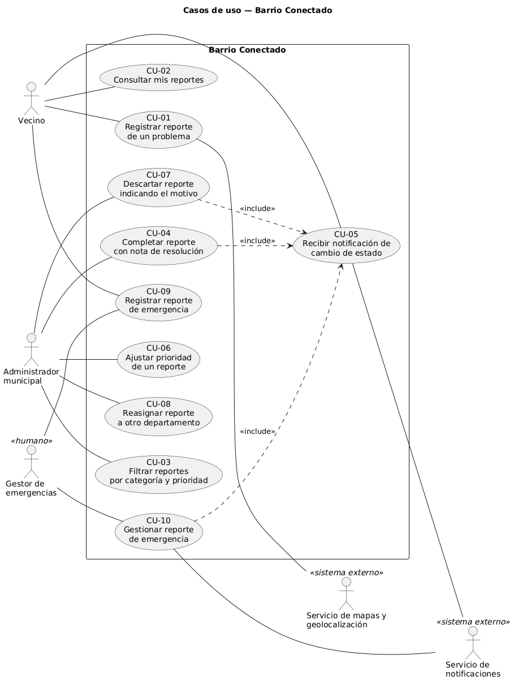

# Casos de uso

## Actores

| Actor | Tipo (humano / sistema externo) | Descripción |
|---|---|---|
| Vecino | Humano | Usuario registrado que reporta problemas en la via publica y realiza seguimiento.|
| Administrador municipal | Humano | Funcionario que filtra, prioriza, asigna y actualiza el estado de los reportes.|
| Sistema de Geolocalizacion | Sistema externo | Servicio de mapas que provee y valida coordenadas geograficas para las ubicaciones.|
| Sistema de Notificaciones | Sistema externo | Plataforma encargada de despachar los avisos al vecino cuando hay cambios de estado.|
| Gestor de emergencias | Humano | Funcionario que analiza los reportes de emergencia y se comunica con la municipalidad o autoridades correspondientes.|

## Diagrama de casos de uso

Archivo fuente: [`./diagramas/casos-de-uso.puml`](./diagramas/casos-de-uso.puml)

## Casos de uso y su origen

| ID | Caso de uso (objetivo del actor) | Actor principal | Historia de origen |
|---|---|---|---|
| CU-01 | Registrar un reporte de incidente | Vecino | [HU-01](./04-historias-usuario.md#hu-01) |
| CU-02 | Consultar historial de reportes | Vecino | [HU-02](./04-historias-usuario.md#hu-02) |
| CU-03 | Filtrar reportes para asignacion | Administrador municipal | [HU-03](./04-historias-usuario.md#hu-03) |
| CU-04 | Completar reporte con nota de resolucion | Administrador municipal | [HU-04](./04-historias-usuario.md#hu-04) |
| CU-05 | Recibir notificación de cambio de estado | Vecino | [HU-05](./04-historias-usuario.md#hu-05) |
| CU-06 | Ajustar prioridad de un reporte | Administrador municipal | [HU-06](./04-historias-usuario.md#hu-06) |
| CU-07 | Descartar reporte indicando el motivo | Administrador municipal | [HU-07](./04-historias-usuario.md#hu-07) |
| CU-08 | Reasignar reporte a otro departamento | Administrador municipal | [HU-08](./04-historias-usuario.md#hu-08) |
| CU-09 | Registrar reporte de emergencia | Vecino | [HU-09](./04-historias-usuario.md#hu-09) |
| CU-10 | Gestionar reporte de emergencia | Gestor de emergencias | [HU-09](./04-historias-usuario.md#hu-09) |

