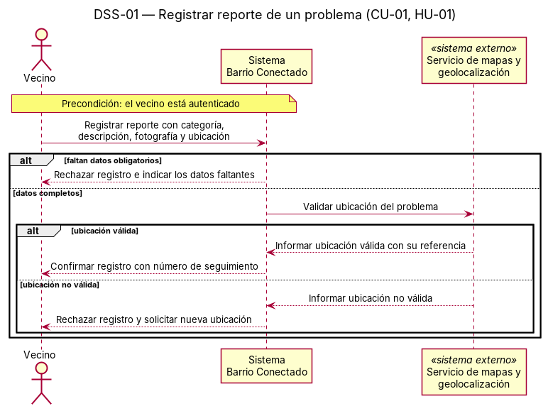
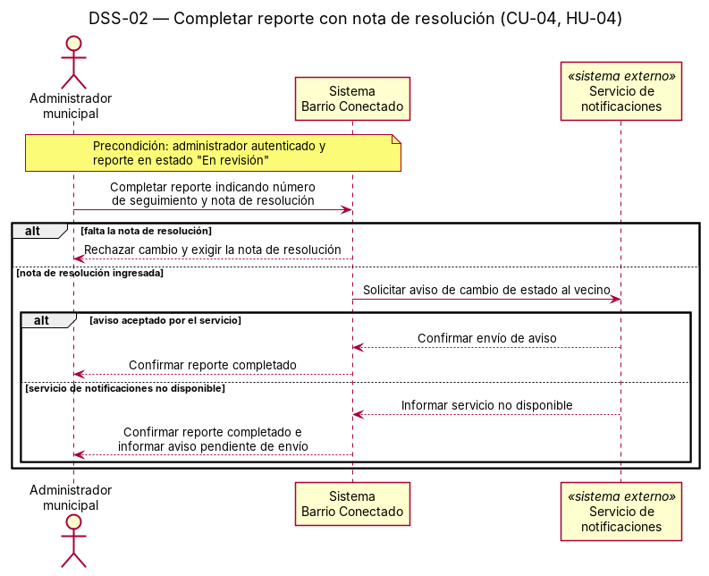

# Diagramas de secuencia de sistema

## DSS-01 — [Nombre del escenario]

- Caso de uso: [CU-01](./09-casos-de-uso.md)
- Historia: [HU-01](./04-historias-usuario.md#hu-01)
- Sistemas externos que participan: [nombre]

Archivo fuente: [`./diagramas/dss-01.puml`](./diagramas/dss-01.puml)

Variantes representadas: [descripción de cada alt/opt/loop]

## DSS-02 — [Nombre del escenario]

- Caso de uso: [CU-02](./09-casos-de-uso.md)
- Historia: [HU-02](./04-historias-usuario.md#hu-02)
- Sistemas externos que participan: [nombre]

Archivo fuente: [`./diagramas/dss-02.puml`](./diagramas/dss-02.puml)

Variantes representadas: [descripción de cada alt/opt/loop]
