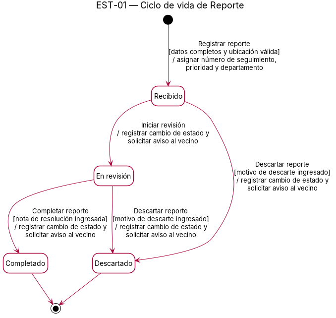
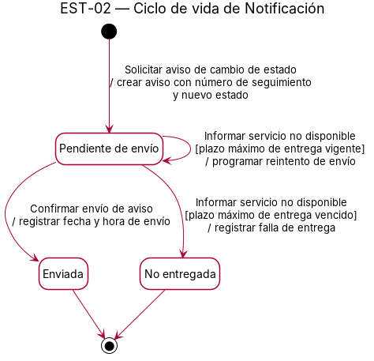

# Diagramas de estado

## EST-01 — Ciclo de vida de [Clase]

- Clase del dominio: [Clase](./08-modelo-dominio.md)
- Diagramas de secuencia relacionados: [DSS-01](./10-diagramas-secuencia.md)

Archivo fuente: [`./diagramas/est-01.puml`](./diagramas/est-01.puml)

### Tabla de transiciones

| Estado origen | Evento | Guarda | Acción | Estado destino |
|---|---|---|---|---|
| [Estado] | [evento] | [condición o ---] | [acción o ---] | [Estado] |

## EST-02 — Ciclo de vida de [Clase]

- Clase del dominio: [Clase](./08-modelo-dominio.md)
- Diagramas de secuencia relacionados: [DSS-02](./10-diagramas-secuencia.md)

Archivo fuente: [`./diagramas/est-02.puml`](./diagramas/est-02.puml)

### Tabla de transiciones

| Estado origen | Evento | Guarda | Acción | Estado destino |
|---|---|---|---|---|
| [Estado] | [evento] | [condición o ---] | [acción o ---] | [Estado] |
