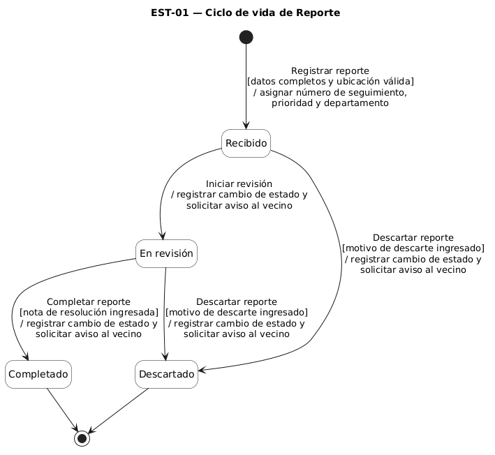
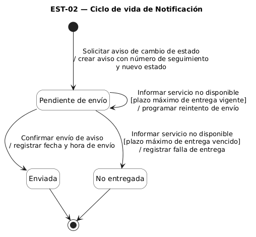
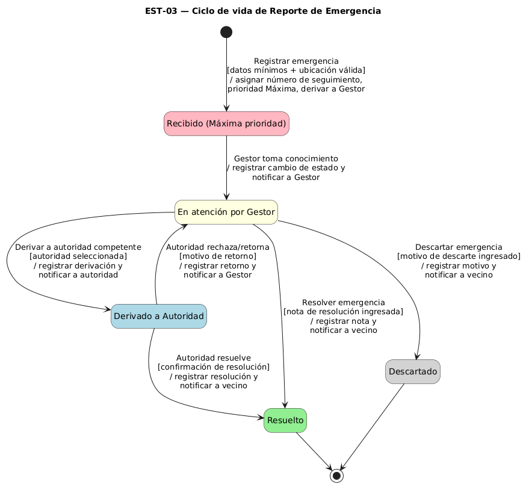

# Diagramas de estado

## EST-01 — Ciclo de vida de reportes

- Clase del dominio: [Reporte](./08-modelo-dominio.md)
- Diagramas de secuencia relacionados: [DSS-01](./10-diagramas-secuencia.md)

Archivo fuente: [`./diagramas/est-01.puml`](./diagramas/est-01.puml)

### Tabla de transiciones

| Estado origen | Evento | Guarda | Acción | Estado destino |
|---|---|---|---|---|
| [*] | registrarReporte() | coordenadasValidas == true | crearRegistroYAsignarDepartamento() | Recibido |
| Recibido | tomarConocimiento() | — | registrarCambioEstado() | EnRevisión |
| EnRevisión | completarReporte() | notaResolucion != vacía | registrarNotaYGenerarNotificacion() | Completado |
| EnRevisión | descartarReporte() | motivoDescarte != vacío | registrarMotivoYGenerarNotificacion() | Descartado |
| Completado | [*] | — | — | [*] |
| Descartado | [*] | — | — | [*] |

## EST-02 — Ciclo de vida de Notificacion

- Clase del dominio: [Notificacion](./08-modelo-dominio.md)
- Diagramas de secuencia relacionados: [DSS-02](./10-diagramas-secuencia.md)

Archivo fuente: [`./diagramas/est-02.puml`](./diagramas/est-02.puml)

### Tabla de transiciones

| Estado origen | Evento | Guarda | Acción | Estado destino |
|---|---|---|---|---|
| [*] | generarNotificacion() | — | encolarMensaje() | PendienteDeEnvío |
| PendienteDeEnvío | enviarNotificacion() | conexionExternaExitosa == true | registrarFechaHoraEnvio() | Enviada |
| PendienteDeEnvío | enviarNotificacion() | conexionExternaExitosa == false | reportarErrorEnvio() | Fallida |
| Enviada | [*] | — | — | [*] |
| Fallida | [*] | — | — | [*] |

## EST-03 — Ciclo de vida de Reporte de Emergencia

- Clase del dominio: [Reporte](./08-modelo-dominio.md) (con esEmergencia = true)
- Diagramas de secuencia relacionados: [DSS-03](./10-diagramas-secuencia.md)

Archivo fuente: [`./diagramas/est-03.puml`](./diagramas/est-03.puml)

### Tabla de transiciones

| Estado origen | Evento | Guarda | Acción | Estado destino |
|---|---|---|---|---|
| [*] | registrarEmergencia() | datosMinimosCompletos && ubicacionValida | crearRegistroPrioridadMaximaDerivarGestor() | Recibido (Máxima prioridad) |
| Recibido (Máxima prioridad) | gestorTomaConocimiento() | — | registrarCambioEstadoNotificarGestor() | En atención por Gestor |
| En atención por Gestor | derivarAutoridad() | autoridadSeleccionada | registrarDerivacionNotificarAutoridad() | Derivado a Autoridad |
| En atención por Gestor | resolverEmergencia() | notaResolucion != vacía | registrarNotaNotificarVecino() | Resuelto |
| En atención por Gestor | descartarEmergencia() | motivoDescarte != vacío | registrarMotivoNotificarVecino() | Descartado |
| Derivado a Autoridad | autoridadResuelve() | confirmacionResolucion | registrarResolucionNotificarVecino() | Resuelto |
| Derivado a Autoridad | autoridadRetorna() | motivoRetorno | registrarRetornoNotificarGestor() | En atención por Gestor |
| Resuelto | [*] | — | — | [*] |
| Descartado | [*] | — | — | [*] |
