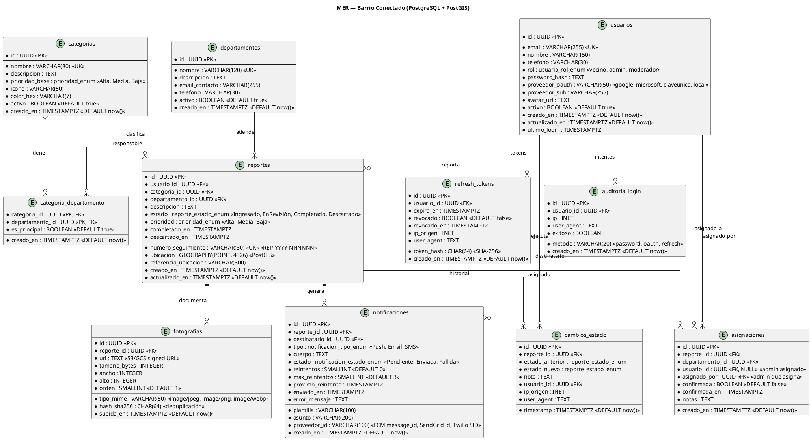

# Diseño de Base de Datos — Barrio Conectado

Este documento especifica el **Modelo Entidad-Relación (MER)**, el **esquema físico DDL** para **PostgreSQL 16 + PostGIS 3.4**, **migraciones versionadas**, **datos semilla** y **consultas geoespaciales clave**.

---

## 1. Modelo Entidad-Relación (MER)

### Diagrama MER (PlantUML)

**Fuente:** `./diagramas/mer.puml`
**Imagen:** `./diagramas/mer.png`



---

## 2. Tipos Enumerados (ENUMs)

```sql
-- 00_enums.sql
CREATE TYPE usuario_rol_enum AS ENUM ('vecino', 'admin', 'moderador');
CREATE TYPE prioridad_enum AS ENUM ('Alta', 'Media', 'Baja');
CREATE TYPE reporte_estado_enum AS ENUM ('Ingresado', 'EnRevisión', 'Completado', 'Descartado');
CREATE TYPE notificacion_tipo_enum AS ENUM ('Push', 'Email', 'SMS');
CREATE TYPE notificacion_estado_enum AS ENUM ('Pendiente', 'Enviada', 'Fallida');
```

---

## 3. Esquema Físico (DDL Completo)

### 3.1 Tablas Principales

```sql
-- 01_tablas_principales.sql
-- Habilitar extensiones
CREATE EXTENSION IF NOT EXISTS "uuid-ossp";
CREATE EXTENSION IF NOT EXISTS "postgis";
CREATE EXTENSION IF NOT EXISTS "pgcrypto"; -- para gen_random_uuid()

-- Tabla: usuarios
CREATE TABLE usuarios (
    id UUID PRIMARY KEY DEFAULT gen_random_uuid(),
    email VARCHAR(255) NOT NULL UNIQUE,
    nombre VARCHAR(150) NOT NULL,
    telefono VARCHAR(30),
    rol usuario_rol_enum NOT NULL DEFAULT 'vecino',
    password_hash TEXT, -- NULL si solo OAuth
    proveedor_oauth VARCHAR(50), -- 'google', 'microsoft', 'claveunica', 'local'
    proveedor_sub VARCHAR(255), -- subject del proveedor OAuth
    avatar_url TEXT,
    activo BOOLEAN NOT NULL DEFAULT true,
    creado_en TIMESTAMPTZ NOT NULL DEFAULT now(),
    actualizado_en TIMESTAMPTZ NOT NULL DEFAULT now(),
    ultimo_login TIMESTAMPTZ,
    CONSTRAINT chk_email_format CHECK (email ~* '^[A-Za-z0-9._%+-]+@[A-Za-z0-9.-]+\.[A-Za-z]{2,}$')
);

CREATE INDEX idx_usuarios_rol ON usuarios(rol);
CREATE INDEX idx_usuarios_proveedor ON usuarios(proveedor_oauth, proveedor_sub);
CREATE INDEX idx_usuarios_activo ON usuarios(activo) WHERE activo;

-- Tabla: categorias
CREATE TABLE categorias (
    id UUID PRIMARY KEY DEFAULT gen_random_uuid(),
    nombre VARCHAR(80) NOT NULL UNIQUE,
    descripcion TEXT,
    prioridad_base prioridad_enum NOT NULL DEFAULT 'Media',
    icono VARCHAR(50), -- nombre icono (ej. 'lightbulb', 'trash', 'road')
    color_hex VARCHAR(7) CHECK (color_hex ~* '^#[0-9A-Fa-f]{6}$'), -- #RRGGBB
    activo BOOLEAN NOT NULL DEFAULT true,
    creado_en TIMESTAMPTZ NOT NULL DEFAULT now()
);

-- Tabla: departamentos
CREATE TABLE departamentos (
    id UUID PRIMARY KEY DEFAULT gen_random_uuid(),
    nombre VARCHAR(120) NOT NULL UNIQUE,
    descripcion TEXT,
    email_contacto VARCHAR(255),
    telefono VARCHAR(30),
    activo BOOLEAN NOT NULL DEFAULT true,
    creado_en TIMESTAMPTZ NOT NULL DEFAULT now()
);

-- Tabla: categoria_departamento (N:M con principal)
CREATE TABLE categoria_departamento (
    categoria_id UUID NOT NULL REFERENCES categorias(id) ON DELETE RESTRICT,
    departamento_id UUID NOT NULL REFERENCES departamentos(id) ON DELETE RESTRICT,
    es_principal BOOLEAN NOT NULL DEFAULT true,
    creado_en TIMESTAMPTZ NOT NULL DEFAULT now(),
    PRIMARY KEY (categoria_id, departamento_id)
);

-- Índice para buscar departamento principal de una categoría
CREATE INDEX idx_cat_dept_principal ON categoria_departamento(categoria_id) WHERE es_principal;

-- Tabla: reportes (CORE)
CREATE TABLE reportes (
    id UUID PRIMARY KEY DEFAULT gen_random_uuid(),
    numero_seguimiento VARCHAR(30) NOT NULL UNIQUE,
    usuario_id UUID NOT NULL REFERENCES usuarios(id) ON DELETE RESTRICT,
    categoria_id UUID NOT NULL REFERENCES categorias(id) ON DELETE RESTRICT,
    departamento_id UUID NOT NULL REFERENCES departamentos(id) ON DELETE RESTRICT,
    descripcion TEXT NOT NULL,
    estado reporte_estado_enum NOT NULL DEFAULT 'Ingresado',
    prioridad prioridad_enum NOT NULL DEFAULT 'Media',
    ubicacion GEOGRAPHY(POINT, 4326) NOT NULL, -- PostGIS: WGS84, metros reales
    referencia_ubicacion VARCHAR(300), -- "Esquina Av. Principal c/ Calle 5"
    creado_en TIMESTAMPTZ NOT NULL DEFAULT now(),
    actualizado_en TIMESTAMPTZ NOT NULL DEFAULT now(),
    completado_en TIMESTAMPTZ,
    descartado_en TIMESTAMPTZ
);

-- Índices críticos para reportes
CREATE INDEX idx_reportes_usuario ON reportes(usuario_id);
CREATE INDEX idx_reportes_estado ON reportes(estado);
CREATE INDEX idx_reportes_prioridad ON reportes(prioridad);
CREATE INDEX idx_reportes_categoria ON reportes(categoria_id);
CREATE INDEX idx_reportes_departamento ON reportes(departamento_id);
CREATE INDEX idx_reportes_creado_en ON reportes(creado_en DESC);
-- Índice compuesto para filtros admin típicos
CREATE INDEX idx_reportes_filtros_admin ON reportes(estado, prioridad, categoria_id, departamento_id);
-- Índice geoespacial (GiST) para consultas de proximidad
CREATE INDEX idx_reportes_ubicacion_gist ON reportes USING GIST (ubicacion);
-- Índice para búsqueda por número de seguimiento (ya es UNIQUE)
-- Índice parcial para reportes activos (no completados/descartados)
CREATE INDEX idx_reportes_activos ON reportes(creado_en DESC) WHERE estado IN ('Ingresado', 'EnRevisión');

-- Trigger para actualizado_en
CREATE OR REPLACE FUNCTION trigger_actualizado_en()
RETURNS TRIGGER LANGUAGE plpgsql AS $$
BEGIN
    NEW.actualizado_en = now();
    RETURN NEW;
END $$;

CREATE TRIGGER trg_reportes_actualizado_en
BEFORE UPDATE ON reportes
FOR EACH ROW EXECUTE FUNCTION trigger_actualizado_en();

-- Tabla: fotografias
CREATE TABLE fotografias (
    id UUID PRIMARY KEY DEFAULT gen_random_uuid(),
    reporte_id UUID NOT NULL REFERENCES reportes(id) ON DELETE CASCADE,
    url TEXT NOT NULL, -- URL firmada S3/GCS
    tipo_mime VARCHAR(50) NOT NULL CHECK (tipo_mime IN ('image/jpeg', 'image/png', 'image/webp', 'image/heic')),
    tamano_bytes INTEGER NOT NULL CHECK (tamano_bytes > 0 AND tamano_bytes <= 10485760), -- max 10MB
    ancho INTEGER,
    alto INTEGER,
    hash_sha256 CHAR(64) NOT NULL, -- para deduplicación
    orden SMALLINT NOT NULL DEFAULT 1,
    subida_en TIMESTAMPTZ NOT NULL DEFAULT now()
);

CREATE INDEX idx_fotografias_reporte ON fotografias(reporte_id, orden);
CREATE UNIQUE INDEX idx_fotografias_hash ON fotografias(hash_sha256); -- deduplicación global

-- Tabla: cambios_estado (AUDITORÍA INMUTABLE)
CREATE TABLE cambios_estado (
    id UUID PRIMARY KEY DEFAULT gen_random_uuid(),
    reporte_id UUID NOT NULL REFERENCES reportes(id) ON DELETE RESTRICT,
    estado_anterior reporte_estado_enum,
    estado_nuevo reporte_estado_enum NOT NULL,
    nota TEXT, -- obligatorio para Completado/Descartado (validado en app)
    usuario_id UUID NOT NULL REFERENCES usuarios(id) ON DELETE RESTRICT,
    timestamp TIMESTAMPTZ NOT NULL DEFAULT now(),
    ip_origen INET,
    user_agent TEXT
);

CREATE INDEX idx_cambios_estado_reporte ON cambios_estado(reporte_id, timestamp DESC);
CREATE INDEX idx_cambios_estado_usuario ON cambios_estado(usuario_id, timestamp DESC);

-- Tabla: asignaciones
CREATE TABLE asignaciones (
    id UUID PRIMARY KEY DEFAULT gen_random_uuid(),
    reporte_id UUID NOT NULL REFERENCES reportes(id) ON DELETE RESTRICT,
    departamento_id UUID NOT NULL REFERENCES departamentos(id) ON DELETE RESTRICT,
    usuario_id UUID REFERENCES usuarios(id) ON DELETE SET NULL, -- admin asignado
    asignado_por UUID NOT NULL REFERENCES usuarios(id) ON DELETE RESTRICT, -- admin que asigna
    confirmada BOOLEAN NOT NULL DEFAULT false,
    confirmada_en TIMESTAMPTZ,
    notas TEXT,
    creado_en TIMESTAMPTZ NOT NULL DEFAULT now()
);

CREATE INDEX idx_asignaciones_reporte ON asignaciones(reporte_id, creado_en DESC);
CREATE INDEX idx_asignaciones_usuario ON asignaciones(usuario_id, confirmada) WHERE NOT confirmada;

-- Tabla: notificaciones
CREATE TABLE notificaciones (
    id UUID PRIMARY KEY DEFAULT gen_random_uuid(),
    reporte_id UUID NOT NULL REFERENCES reportes(id) ON DELETE RESTRICT,
    destinatario_id UUID NOT NULL REFERENCES usuarios(id) ON DELETE RESTRICT,
    tipo notificacion_tipo_enum NOT NULL,
    plantilla VARCHAR(100) NOT NULL, -- 'reporte_creado', 'estado_cambiado', 'completado', 'descartado'
    asunto VARCHAR(200) NOT NULL,
    cuerpo TEXT NOT NULL,
    estado notificacion_estado_enum NOT NULL DEFAULT 'Pendiente',
    proveedor_id VARCHAR(100), -- FCM message_id, SendGrid message_id, Twilio SID
    reintentos SMALLINT NOT NULL DEFAULT 0,
    max_reintentos SMALLINT NOT NULL DEFAULT 3,
    proximo_reintento TIMESTAMPTZ,
    enviado_en TIMESTAMPTZ,
    error_mensaje TEXT,
    creado_en TIMESTAMPTZ NOT NULL DEFAULT now()
);

CREATE INDEX idx_notificaciones_estado_reintento ON notificaciones(estado, proximo_reintento) WHERE estado = 'Pendiente';
CREATE INDEX idx_notificaciones_destinatario ON notificaciones(destinatario_id, creado_en DESC);
CREATE INDEX idx_notificaciones_reporte ON notificaciones(reporte_id);

-- Tabla: refresh_tokens (JWT refresh rotation)
CREATE TABLE refresh_tokens (
    id UUID PRIMARY KEY DEFAULT gen_random_uuid(),
    usuario_id UUID NOT NULL REFERENCES usuarios(id) ON DELETE CASCADE,
    token_hash CHAR(64) NOT NULL, -- SHA-256 del token
    expira_en TIMESTAMPTZ NOT NULL,
    revocado BOOLEAN NOT NULL DEFAULT false,
    revocado_en TIMESTAMPTZ,
    ip_origen INET,
    user_agent TEXT,
    creado_en TIMESTAMPTZ NOT NULL DEFAULT now()
);

CREATE INDEX idx_refresh_tokens_usuario ON refresh_tokens(usuario_id, revocado) WHERE NOT revocado;
CREATE INDEX idx_refresh_tokens_expira ON refresh_tokens(expira_en) WHERE NOT revocado;

-- Tabla: auditoria_login
CREATE TABLE auditoria_login (
    id UUID PRIMARY KEY DEFAULT gen_random_uuid(),
    usuario_id UUID REFERENCES usuarios(id) ON DELETE SET NULL,
    ip INET NOT NULL,
    user_agent TEXT,
    exitoso BOOLEAN NOT NULL,
    metodo VARCHAR(20) NOT NULL CHECK (metodo IN ('password', 'oauth', 'refresh')),
    creado_en TIMESTAMPTZ NOT NULL DEFAULT now()
);

CREATE INDEX idx_auditoria_login_usuario ON auditoria_login(usuario_id, creado_en DESC);
CREATE INDEX idx_auditoria_login_ip ON auditoria_login(ip, creado_en DESC);
```

---

### 3.2 Funciones y Triggers de Negocio

```sql
-- 02_funciones_triggers.sql

-- Función: Generar número de seguimiento único (REP-YYYY-NNNNNN)
CREATE OR REPLACE FUNCTION generar_numero_seguimiento()
RETURNS VARCHAR(30) LANGUAGE plpgsql AS $$
DECLARE
    seq_num INTEGER;
    year_part VARCHAR(4) := TO_CHAR(now(), 'YYYY');
    result VARCHAR(30);
BEGIN
    LOOP
        -- Secuencia por año (reinicia cada año)
        SELECT COALESCE(MAX(CAST(SUBSTRING(numero_seguimiento FROM 'REP-\d{4}-(\d{6})') AS INTEGER)), 0) + 1
        INTO seq_num
        FROM reportes
        WHERE numero_seguimiento LIKE 'REP-' || year_part || '-%';
        
        result := 'REP-' || year_part || '-' || LPAD(seq_num::TEXT, 6, '0');
        
        -- Verificar unicidad (race condition improbable pero seguro)
        IF NOT EXISTS (SELECT 1 FROM reportes WHERE numero_seguimiento = result) THEN
            RETURN result;
        END IF;
    END LOOP;
END $$;

-- Trigger: Asignar numero_seguimiento, prioridad y departamento al INSERT
CREATE OR REPLACE FUNCTION trg_reportes_before_insert()
RETURNS TRIGGER LANGUAGE plpgsql AS $$
DECLARE
    v_prioridad prioridad_enum;
    v_departamento_id UUID;
BEGIN
    -- Número de seguimiento
    NEW.numero_seguimiento := generar_numero_seguimiento();
    
    -- Prioridad base desde categoría
    SELECT prioridad_base INTO v_prioridad FROM categorias WHERE id = NEW.categoria_id;
    NEW.prioridad := v_prioridad;
    
    -- Departamento principal desde categoría_departamento
    SELECT departamento_id INTO v_departamento_id
    FROM categoria_departamento
    WHERE categoria_id = NEW.categoria_id AND es_principal = true
    LIMIT 1;
    NEW.departamento_id := v_departamento_id;
    
    RETURN NEW;
END $$;

CREATE TRIGGER trg_reportes_bi
BEFORE INSERT ON reportes
FOR EACH ROW EXECUTE FUNCTION trg_reportes_before_insert();

-- Trigger: Registrar cambio de estado automáticamente
CREATE OR REPLACE FUNCTION trg_reportes_estado_change()
RETURNS TRIGGER LANGUAGE plpgsql AS $$
BEGIN
    IF OLD.estado IS DISTINCT FROM NEW.estado THEN
        INSERT INTO cambios_estado (reporte_id, estado_anterior, estado_nuevo, usuario_id, nota)
        VALUES (NEW.id, OLD.estado, NEW.estado, 
                COALESCE(current_setting('app.current_user_id', true)::UUID, NEW.usuario_id),
                NULL); -- La nota se añade vía aplicación
        
        -- Timestamps de cierre
        IF NEW.estado = 'Completado' THEN
            NEW.completado_en := now();
        ELSIF NEW.estado = 'Descartado' THEN
            NEW.descartado_en := now();
        END IF;
    END IF;
    RETURN NEW;
END $$;

CREATE TRIGGER trg_reportes_estado
BEFORE UPDATE OF estado ON reportes
FOR EACH ROW EXECUTE FUNCTION trg_reportes_estado_change();

-- Función: Validar transición de estado (EST-01)
CREATE OR REPLACE FUNCTION validar_transicion_estado(
    p_estado_actual reporte_estado_enum,
    p_estado_nuevo reporte_estado_enum,
    p_nota TEXT
) RETURNS BOOLEAN LANGUAGE plpgsql AS $$
BEGIN
    -- Transiciones permitidas
    IF p_estado_actual = 'Ingresado' AND p_estado_nuevo IN ('EnRevisión', 'Descartado') THEN
        RETURN p_nota IS NOT NULL AND p_nota <> '' OR p_estado_nuevo = 'EnRevisión';
    ELSIF p_estado_actual = 'EnRevisión' AND p_estado_nuevo IN ('Completado', 'Descartado') THEN
        RETURN p_nota IS NOT NULL AND p_nota <> '';
    END IF;
    RETURN FALSE;
END $$;

-- Trigger: Validar transición en UPDATE
CREATE OR REPLACE FUNCTION trg_validar_transicion()
RETURNS TRIGGER LANGUAGE plpgsql AS $$
DECLARE
    v_nota TEXT;
BEGIN
    IF OLD.estado IS DISTINCT FROM NEW.estado THEN
        -- Obtener nota del contexto (pasada via SET LOCAL en app)
        v_nota := current_setting('app.estado_nota', true);
        
        IF NOT validar_transicion_estado(OLD.estado, NEW.estado, v_nota) THEN
            RAISE EXCEPTION 'Transición inválida: % -> % (nota requerida: %)', 
                OLD.estado, NEW.estado, 
                CASE WHEN NEW.estado IN ('Completado', 'Descartado') THEN 'SÍ' ELSE 'NO' END;
        END IF;
    END IF;
    RETURN NEW;
END $$;

CREATE TRIGGER trg_validar_transicion
BEFORE UPDATE OF estado ON reportes
FOR EACH ROW EXECUTE FUNCTION trg_validar_transicion();
```

---

### 3.3 Vistas Útiles

```sql
-- 03_vistas.sql

-- Vista: Reporte completo para listados (vecino y admin)
CREATE OR REPLACE VIEW v_reportes_completo AS
SELECT 
    r.id,
    r.numero_seguimiento,
    r.usuario_id,
    u.nombre AS vecino_nombre,
    u.email AS vecino_email,
    r.categoria_id,
    c.nombre AS categoria_nombre,
    c.prioridad_base AS categoria_prioridad_base,
    c.icono AS categoria_icono,
    c.color_hex AS categoria_color,
    r.departamento_id,
    d.nombre AS departamento_nombre,
    r.descripcion,
    r.estado,
    r.prioridad,
    ST_X(r.ubicacion::geometry) AS longitud,
    ST_Y(r.ubicacion::geometry) AS latitud,
    r.referencia_ubicacion,
    r.creado_en,
    r.actualizado_en,
    r.completado_en,
    r.descartado_en,
    -- Último cambio de estado
    ce.timestamp AS ultima_actualizacion_estado,
    ce.nota AS ultima_nota,
    ce.usuario_id AS ultimo_usuario_cambio,
    -- Conteo fotos
    COUNT(f.id) AS total_fotos,
    -- Asignación actual
    a.usuario_id AS admin_asignado_id,
    a.confirmada AS asignacion_confirmada,
    a.confirmada_en
FROM reportes r
JOIN usuarios u ON u.id = r.usuario_id
JOIN categorias c ON c.id = r.categoria_id
JOIN departamentos d ON d.id = r.departamento_id
LEFT JOIN cambios_estado ce ON ce.reporte_id = r.id 
    AND ce.timestamp = (SELECT MAX(timestamp) FROM cambios_estado WHERE reporte_id = r.id)
LEFT JOIN fotografias f ON f.reporte_id = r.id
LEFT JOIN LATERAL (
    SELECT * FROM asignaciones 
    WHERE reporte_id = r.id 
    ORDER BY creado_en DESC LIMIT 1
) a ON true
GROUP BY r.id, u.nombre, u.email, c.nombre, c.prioridad_base, c.icono, c.color_hex, 
         d.nombre, ce.timestamp, ce.nota, ce.usuario_id, a.usuario_id, a.confirmada, a.confirmada_en;

-- Vista: Estadísticas para dashboard admin
CREATE OR REPLACE VIEW v_estadisticas_dashboard AS
SELECT 
    COUNT(*) FILTER (WHERE estado = 'Ingresado') AS ingresados,
    COUNT(*) FILTER (WHERE estado = 'EnRevisión') AS en_revision,
    COUNT(*) FILTER (WHERE estado = 'Completado') AS completados,
    COUNT(*) FILTER (WHERE estado = 'Descartado') AS descartados,
    COUNT(*) FILTER (WHERE prioridad = 'Alta') AS prioridad_alta,
    COUNT(*) FILTER (WHERE prioridad = 'Media') AS prioridad_media,
    COUNT(*) FILTER (WHERE prioridad = 'Baja') AS prioridad_baja,
    COUNT(*) FILTER (WHERE creado_en >= now() - INTERVAL '24 hours') AS ultimas_24h,
    COUNT(*) FILTER (WHERE creado_en >= now() - INTERVAL '7 days') AS ultimos_7d,
    COUNT(*) FILTER (WHERE creado_en >= now() - INTERVAL '30 days') AS ultimos_30d,
    AVG(EXTRACT(EPOCH FROM (completado_en - creado_en))/3600) 
        FILTER (WHERE estado = 'Completado' AND completado_en IS NOT NULL) AS horas_promedio_resolucion
FROM reportes;

-- Vista: Reportes geoespaciales para mapa (clustering)
CREATE OR REPLACE VIEW v_reportes_mapa AS
SELECT 
    id,
    numero_seguimiento,
    categoria_id,
    c.nombre AS categoria_nombre,
    c.icono AS categoria_icono,
    c.color_hex AS categoria_color,
    estado,
    prioridad,
    ST_AsGeoJSON(ubicacion)::json AS geojson,
    referencia_ubicacion,
    creado_en
FROM reportes r
JOIN categorias c ON c.id = r.categoria_id
WHERE estado IN ('Ingresado', 'EnRevisión');
```

---

## 4. Migraciones Versionadas (Formato Flyway / Golang Migrate)

Estructura de carpetas:
```
migrations/
├── V001__enums.sql
├── V002__tablas_principales.sql
├── V003__funciones_triggers.sql
├── V004__vistas.sql
├── V005__datos_semilla.sql
├── V006__indices_adicionales.sql
└── V007__rls_policies.sql          -- Row Level Security (opcional)
```

### V005 - Datos Semilla (Catálogos Iniciales)

```sql
-- V005__datos_semilla.sql

-- Categorías base
INSERT INTO categorias (nombre, descripcion, prioridad_base, icono, color_hex) VALUES
('Luminaria', 'Alumbrado público: postes, lámparas, cableado', 'Alta', 'lightbulb', '#FFD600'),
('Microbasural', 'Acumulación de residuos en vía pública', 'Media', 'delete', '#EF6C00'),
('Bache', 'Deterioro de carpeta asfáltica, hoyos en calzada', 'Alta', 'road', '#C62828'),
('Señalética', 'Señales de tránsito dañadas o faltantes', 'Media', 'sign', '#1565C0'),
('Vereda', 'Aceras rotas, desniveles, obstáculos peatonales', 'Media', 'directions_walk', '#2E7D32'),
('Parques/Plazas', 'Juegos, bancas, áreas verdes, riego', 'Baja', 'park', '#388E3C'),
('Drenaje', 'Sumideros tapados, anegamientos, cunetas', 'Alta', 'water', '#0277BD'),
('Otro', 'Problemas no clasificados en categorías anteriores', 'Baja', 'help', '#757575')
ON CONFLICT (nombre) DO NOTHING;

-- Departamentos base
INSERT INTO departamentos (nombre, descripcion, email_contacto, telefono) VALUES
('Alumbrado Público', 'Mantenimiento y reparación de luminarias', 'alumbrado@municipio.cl', '+56 32 123456'),
('Aseo y Ornato', 'Limpieza, recolección, microbasurales', 'aseo@municipio.cl', '+56 32 123457'),
('Obras Viales', 'Baches, pavimento, calzadas, veredas', 'obras@municipio.cl', '+56 32 123458'),
('Tránsito y Transporte', 'Señalética, semáforos, fiscalización', 'transito@municipio.cl', '+56 32 123459'),
('Parques y Jardines', 'Mantenimiento áreas verdes, plazas', 'parques@municipio.cl', '+56 32 123460'),
('Drenaje y Alcantarillado', 'Red de aguas lluvia, sumideros', 'drenaje@municipio.cl', '+56 32 123461'),
('Obras Públicas General', 'Coordinación general y otros', 'obraspublicas@municipio.cl', '+56 32 123462')
ON CONFLICT (nombre) DO NOTHING;

-- Relación Categoría ↔ Departamento (principal)
INSERT INTO categoria_departamento (categoria_id, departamento_id, es_principal)
SELECT c.id, d.id, true
FROM categorias c, departamentos d
WHERE (c.nombre, d.nombre) IN (
    ('Luminaria', 'Alumbrado Público'),
    ('Microbasural', 'Aseo y Ornato'),
    ('Bache', 'Obras Viales'),
    ('Señalética', 'Tránsito y Transporte'),
    ('Vereda', 'Obras Viales'),
    ('Parques/Plazas', 'Parques y Jardines'),
    ('Drenaje', 'Drenaje y Alcantarillado'),
    ('Otro', 'Obras Públicas General')
)
ON CONFLICT (categoria_id, departamento_id) DO NOTHING;

-- Usuario admin por defecto (password: cambiar en primer login)
-- Hash Argon2id de "Admin123!" (generar con script)
INSERT INTO usuarios (email, nombre, telefono, rol, password_hash, activo)
VALUES ('admin@municipio.cl', 'Administrador Municipal', '+56 9 1234 5678', 'admin', 
        '$argon2id$v=19$m=65536,t=3,p=4$...', true)
ON CONFLICT (email) DO NOTHING;
```

---

## 5. Consultas Geoespaciales Clave (PostGIS)

```sql
-- 5.1 Reportes en radio de 500m de un punto (para mapa vecino)
SELECT r.id, r.numero_seguimiento, r.categoria_id, c.nombre AS categoria,
       c.icono, c.color_hex, r.estado, r.prioridad,
       ST_Distance(r.ubicacion, ST_SetSRID(ST_MakePoint(:lon, :lat), 4326)::geography) AS distancia_m,
       ST_AsGeoJSON(r.ubicacion)::json AS geojson
FROM reportes r
JOIN categorias c ON c.id = r.categoria_id
WHERE ST_DWithin(
    r.ubicacion,
    ST_SetSRID(ST_MakePoint(:lon, :lat), 4326)::geography,
    500 -- metros
)
AND r.estado IN ('Ingresado', 'EnRevisión')
ORDER BY distancia_m
LIMIT 100;

-- 5.2 Reportes dentro de un polígono (límite comuna/barrio)
SELECT r.id, r.numero_seguimiento, r.estado, r.prioridad,
       ST_AsGeoJSON(r.ubicacion)::json AS geojson
FROM reportes r
WHERE ST_Contains(
    (SELECT geom FROM limites_comuna WHERE codigo = :comuna_codigo),
    r.ubicacion::geometry
)
AND r.estado IN ('Ingresado', 'EnRevisión');

-- 5.3 Clustering para mapa (agrupar puntos cercanos)
SELECT 
    ST_ClusterDBSCAN(ubicacion::geometry, eps := 100, minpoints := 2) OVER () AS cluster_id,
    COUNT(*) OVER (PARTITION BY ST_ClusterDBSCAN(ubicacion::geometry, eps := 100, minpoints := 2) OVER ()) AS cluster_size,
    ST_Centroid(ST_Collect(ubicacion::geometry)) OVER (PARTITION BY ST_ClusterDBSCAN(ubicacion::geometry, eps := 100, minpoints := 2) OVER ()) AS cluster_center,
    id, numero_seguimiento, categoria_id, estado, prioridad
FROM reportes
WHERE estado IN ('Ingresado', 'EnRevisión')
  AND creado_en >= now() - INTERVAL '30 days';

-- 5.4 Heatmap: densidad de reportes por hexágono (H3 o grid)
SELECT 
    ST_HexagonGrid(500, ST_Expand(ST_Extent(ubicacion::geometry), 1000)) AS hex,
    COUNT(r.id) AS cantidad
FROM reportes r
WHERE r.estado IN ('Ingresado', 'EnRevisión')
  AND r.creado_en >= now() - INTERVAL '90 days'
GROUP BY hex
HAVING COUNT(r.id) > 0;
```

---

## 6. Row Level Security (RLS) - Opcional

```sql
-- 07_rls_policies.sql (habilitar si se usa PostgreSQL como API directa)

ALTER TABLE reportes ENABLE ROW LEVEL SECURITY;

-- Vecino ve solo sus reportes
CREATE POLICY reportes_vecino_select ON reportes
FOR SELECT TO vecino_role
USING (usuario_id = current_setting('app.current_user_id')::UUID);

-- Admin ve todos
CREATE POLICY reportes_admin_all ON reportes
FOR ALL TO admin_role
USING (true);

-- Vecino inserta sus reportes
CREATE POLICY reportes_vecino_insert ON reportes
FOR INSERT TO vecino_role
WITH CHECK (usuario_id = current_setting('app.current_user_id')::UUID);

-- Similar para cambios_estado, notificaciones, etc.
```

---

## 7. Backup, PITR y Mantenimiento

| Política | Configuración |
|----------|---------------|
| **Backups automáticos** | Diarios, retención 30 días |
| **Point-in-Time Recovery (PITR)** | Habilitado, ventana 7 días |
| **Replicación** | Síncrona (HA regional), 1 standby |
| **Autovacuum** | `autovacuum_vacuum_scale_factor = 0.05`, `autovacuum_analyze_scale_factor = 0.02` |
| **Índices** | `REINDEX CONCURRENTLY` mensual en ventana baja |
| **Estadísticas** | `ANALYZE` diario via `pg_stat_clear_snapshot` |

---

## 8. Archivos en el Repositorio

| Archivo | Descripción |
|---------|-------------|
| `14-base-datos.md` | Este documento |
| `diagramas/mer.puml` | MER en PlantUML |
| `migrations/V001__enums.sql` | Tipos enumerados |
| `migrations/V002__tablas_principales.sql` | Tablas, índices, triggers |
| `migrations/V003__funciones_triggers.sql` | Funciones negocio, validaciones |
| `migrations/V004__vistas.sql` | Vistas completas |
| `migrations/V005__datos_semilla.sql` | Catálogos iniciales |
| `migrations/V006__indices_adicionales.sql` | Índices de performance |
| `migrations/V007__rls_policies.sql` | Row Level Security (opcional) |

---

> **Próximo paso:** Generar `15-api-openapi.md` con especificación OpenAPI 3.0 completa.